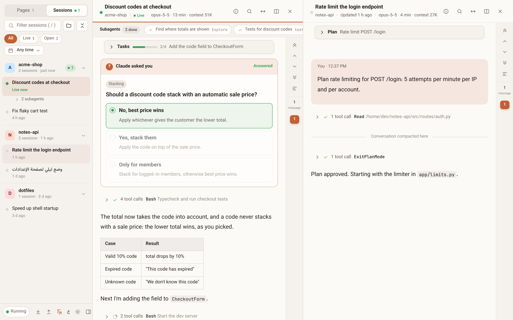
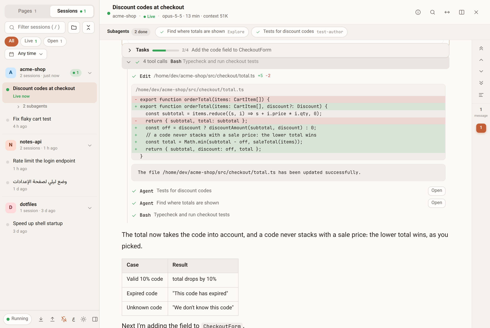
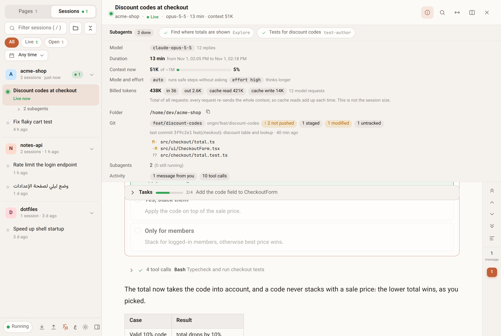
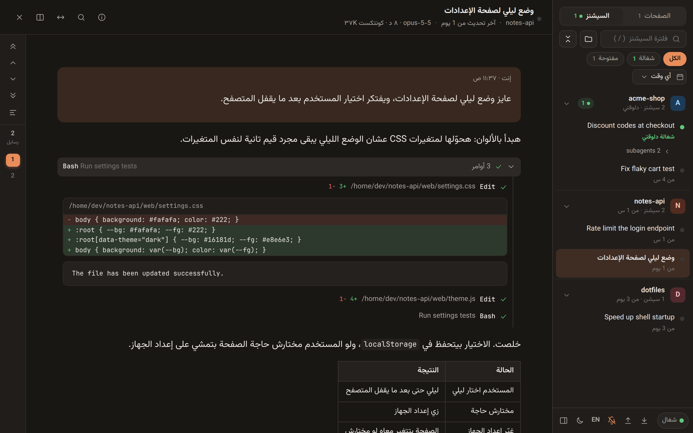

# ccpreview

**See what Claude Code is doing, live, in your browser.**

ccpreview (short for Claude Code preview) reads the transcripts Claude Code already writes to `~/.claude/projects` and turns them into a readable, searchable view: every session, its messages, tool calls, file diffs, subagents, plans, questions and token use, updating as Claude works. It runs on your machine, never talks to Claude, and never uploads anything.

```sh
npx ccpreview
```



## Who it's for

- You run long Claude Code sessions and want to follow them without scrolling a terminal.
- You run several sessions or background subagents at once and want to see which are working, which finished and which are waiting for you.
- You want to go back to what Claude did yesterday: which files it changed, what it ran, what you answered.
- You write in Arabic (or mix Arabic and English) and want text that reads in the right direction.

## Features

### Follow sessions live
- Sessions update as Claude Code writes them, with a "Live" marker and a count of new messages when you're scrolled up.
- Session list grouped by project or by day, with filters: live, waiting for you, open, pinned, a date range and a title search.
- Up to 4 sessions side by side.
- Desktop notifications when a session finishes or is waiting for your answer.

### Read what happened
- Messages rendered as markdown: tables, code, lists. Pasted screenshots show inline.
- Tool calls grouped per turn, with the command or file in the summary and the full output one click away.
- Diffs for `Edit`, `MultiEdit` and `Write`.
- The plan (`ExitPlanMode`) and task list (`TodoWrite`) pinned at the top of the session, with progress.
- `AskUserQuestion` cards that show every option and the one you picked.
- A message rail to jump between your messages, and keys to step through them.
- Search inside a session: Arabic-aware matching, regex, whole word, and a scope selector (everything, your messages, Claude's replies, tool calls).



### Subagents
- A subagents bar per session: each agent's task, type and state (running, done, stopped), and one click to open its own transcript.
- Subagents also appear under their session in the sidebar.

### Session info
Press `i` or the info button for a panel with:
- **Context now**: how much of the context window the latest request used, and when the conversation was last compacted.
- **Mode and effort**: the permission mode (`auto`, `plan`, ...) and the effort level.
- **Billed tokens**: input, output, cache reads and cache writes over all requests.
- **Git** (with `npx ccpreview`): branch, unpushed commits, staged, modified and untracked files, and the last commit.
- Model, duration, folder, tool counts and the files the session changed (click one to jump to its last edit).



### Images
- A viewer with zoom (wheel, `+` `-`, double-click), drag to pan, fit and actual size, image properties, copy, and a thumbnail strip with a hover preview of every image in the session.

### Arabic and right-to-left
- English and Arabic UI, picked from your browser language, with a toggle.
- Each paragraph and line takes the direction of the language most of it is written in, so a line of English inside an Arabic message reads left to right, and the other way round.
- Light and dark themes.



### Notes pad
- Pages with thumbnails for keeping notes next to your sessions. Pasting a terminal box-drawing table or markdown turns it into a real table.

## Quick start

### With npx (every browser)

```sh
npx ccpreview
```

This starts a server on `http://127.0.0.1:4747`, opens it in your browser and reads `~/.claude/projects`. Needs Node 18 or newer.

### Hosted page (Chrome, Edge)

Open <https://mohamedeslam04.github.io/ccpreview/> and pick your `~/.claude/projects` folder once. The browser reads the files directly through the File System Access API. The page remembers the folder and asks for read permission again when needed.

`~/.claude` is a hidden folder, so the picker may not show it:

- Linux (GTK picker): press `Ctrl+H`, or type `~/.claude/projects` with `Ctrl+L`.
- macOS: press `Cmd+Shift+.`.
- Windows: paste `%USERPROFILE%\.claude\projects` into the picker's address bar.

If you pick `~/.claude` (or your home folder) instead of `~/.claude/projects`, ccpreview steps into `projects` for you. The page walks through each step for your system and browser.

Firefox and Safari do not support folder access. Use `npx ccpreview` there.

Special setups:

- **WSL**: if Claude Code runs inside WSL, your sessions live in Linux. Either run `npx ccpreview` inside WSL and open the link it prints in your Windows browser, or in the hosted page pick `\\wsl.localhost\<distro>\home\<you>\.claude`.
- **`CLAUDE_CONFIG_DIR`**: if you moved Claude Code's files with it, `npx ccpreview` and `ccpreview hook install` follow it automatically. In the hosted page, pick that folder.

## Privacy and security

- The server listens on `127.0.0.1` only.
- Every request must carry a `Host` header of `127.0.0.1:<port>` or `localhost:<port>`. This blocks DNS rebinding.
- No CORS headers are sent, so other websites cannot read responses. Writes (`PUT /api/pages`, `POST /api/shutdown`) also require a same-origin `Origin` header.
- Session ids and folder names are validated against a strict pattern, so `..` and hidden folders are rejected. Static files come from a fixed list.
- Nothing is uploaded. There is no analytics, no telemetry and no external request, in either mode.
- Folder mode requests read-only access. The hosted page never writes to your folder.
- Notes are stored in `~/.ccpreview/pages.json` in server mode (with daily backups in `~/.ccpreview/backups`, the last 14 kept) and in the browser's `localStorage` in folder mode.
- The optional hook (off unless you run `ccpreview hook install`) writes only under `~/.ccpreview` and to your `settings.json`, as described above.
- Transcripts can contain secrets and source code. Do not expose the server to a network.

## CLI options

```
ccpreview [options]

  -p, --port <n>       port to listen on (default 4747; 0 picks a free one)
      --projects <dir> Claude Code projects folder (default ~/.claude/projects, or $CLAUDE_CONFIG_DIR/projects)
      --data <dir>     where ccpreview keeps your notes pages (default ~/.ccpreview)
      --no-open        don't open the browser
  -v, --version        print the version
  -h, --help           show this help
```

## Optional: start on login

On Linux, systemd socket activation starts ccpreview the first time you open `http://127.0.0.1:4747/` and costs nothing while idle. See [docs/systemd](https://github.com/MohamedEslam04/ccpreview/tree/main/docs/systemd) for the unit files and setup.

## Optional: see questions while they wait

Claude Code writes a question (`AskUserQuestion`) or a plan to approve (`ExitPlanMode`) to the transcript only after you answer it, so a viewer cannot show one that is still waiting. A small Claude Code hook can. It is off by default and ccpreview works the same without it.

```sh
npx ccpreview hook install     # add the hook
npx ccpreview hook status      # installed or not, and where
npx ccpreview hook uninstall   # remove it
```

With the hook, a waiting question or plan appears as a card at the end of the session, the session shows as "Waiting for you" in the sidebar, and the card disappears once you answer in the terminal. Answering still happens in the terminal.

- `install` only adds its own entries to `~/.claude/settings.json` (`PreToolUse`, `PostToolUse`, `PostToolUseFailure`, `Stop` and `UserPromptSubmit`). Every other setting and hook is left as it is. It is safe to run twice, keeps a backup next to the file as `settings.json.ccpreview-bak`, and refuses to touch a `settings.json` that is not valid JSON.
- `uninstall` removes only those entries, and the empty lists they leave behind.
- The hook script is copied to `~/.ccpreview/hooks/pending-ask.js`, and waiting questions are stored in `~/.ccpreview/pending/<session>.json` (private to your user, deleted when answered, ignored after 12 hours). Nothing is written inside `~/.claude` except your `settings.json`. The hook prints nothing and never blocks Claude Code. With `--data`, ccpreview reads `<dir>/pending`, so keep the default if you use the hook.
- The hosted page cannot read `~/.ccpreview`, so it shows nothing extra. This needs `npx ccpreview`.

## Keyboard shortcuts

| Keys | Action |
| --- | --- |
| `/` | Focus the session filter (sessions tab) |
| `Ctrl+F`, `F3` | Search in the active session; `F3` / `Shift+F3` step to the next / previous hit |
| `Enter`, `Shift+Enter` | Next / previous hit while the search box is focused |
| `Esc` | Close search, lightbox or menus |
| `Home`, `End` | Jump to the first / last message in the active session |
| `Alt+Up`, `Alt+Down` | Previous / next message in the active session (sessions tab); previous / next page (notes tab) |
| `Ctrl+Alt+Left`, `Ctrl+Alt+Right` | Change the content width |
| `Ctrl+\` | Hide or show the sidebar |
| `Alt+1`, `Alt+2` | Notes tab / sessions tab |
| `Ctrl+K` | Search notes pages |
| `Ctrl+Enter` | New notes page |
| `Ctrl+Shift+V` | Paste as plain text (skips the table and markdown conversion) |
| `Left`, `Right` | Next / previous image in the lightbox |
| `i` | Show or hide the session info panel |
| `+`, `-`, `0`, `1` | Zoom in, zoom out, fit, actual size in the image viewer |

## Browser support

| Browser | `npx ccpreview` | Hosted page (folder mode) |
| --- | --- | --- |
| Chrome, Edge | Yes | Yes |
| Brave | Yes | Needs `brave://flags/#file-system-access-api` enabled |
| Firefox | Yes | No, use `npx ccpreview` |
| Safari | Yes | No, use `npx ccpreview` |
| Chrome or Edge older than 86 | Yes | No, the page asks you to update the browser |
| Phones and tablets | Not supported | No, the page asks you to open it on the computer that runs Claude Code |

## How it works

`web/core.js` turns transcript lines into compact events (messages, tool calls, diffs, todos, results) and builds the session list. It has no dependencies and runs unchanged in Node and in the browser. Everything environment-specific (listing files, reading from a byte offset, storing images) goes through a small adapter.

`web/source.js` provides the two modes behind one interface:

- Server mode: `lib/server.js` implements the adapter with `fs` and streams events to the page over Server-Sent Events.
- Folder mode: the page implements the adapter with the File System Access API and runs `core.js` itself.

`web/app.js` is the UI and does not care which mode is active. The hosted page is the `web/` folder published to GitHub Pages.

## Development

```sh
git clone https://github.com/MohamedEslam04/ccpreview.git
cd ccpreview
npm start          # runs bin/ccpreview.js on :4747
npm test           # node:test, no dependencies
```

`npm run dev` starts the server without opening a browser.

## بالعربي

ccpreview بيوريك Claude Code بيعمل إيه دلوقتي، في المتصفح. بيقرا ملفات الـ transcripts اللي Claude Code بيكتبها في `~/.claude/projects` ويعرضها وهي بتتحدّث، من غير ما يكلّم Claude ومن غير ما يرفع أي حاجة.

- **متابعة لحظة بلحظة:** كل السيشنز متقسمة حسب المشروع أو اليوم، فلاتر (شغالة، مستنياك، مفتوحة، متثبتة، تاريخ)، لحد 4 سيشنز جنب بعض، وإشعار لما سيشن تخلص أو تستناك ترد.
- **تقرا اللي حصل:** الرسايل بالـ markdown والجداول، الأوامر متجمعة في كل دور، الـ diffs بتاعة الملفات، الخطة وقايمة المهام متثبتين فوق، كروت أسئلة `AskUserQuestion` والإجابة اللي اخترتها، وبحث جوه السيشن بيفهم العربي.
- **الـ subagents:** شريط لكل سيشن فيه كل agent ومهمته وحالته، وتفتح الـ transcript بتاعه بضغطة.
- **معلومات السيشن (زرار `i`):** الكونتكست دلوقتي ونسبته من الشباك وآخر ضغط، المود والإيفورت، التوكنز المتحاسبة، وحالة git (الفرع، الـ commits اللي لسه ما اترفعتش، الملفات المتعدّلة) مع `npx ccpreview`.
- **الصور:** عارض فيه زوم وسحب وخصائص الصورة وشريط مصغّرات بمعاينة لما تقف عليها.
- **عربي صح:** الواجهة عربي وإنجليزي، وكل سطر بياخد اتجاه اللغة الغالبة فيه، فاللي مكتوب إنجليزي بيتقري من الشمال واللي عربي من اليمين. فاتح وغامق.
- **سؤال مستنيك (اختياري):** لو ركّبت الـ hook بـ `npx ccpreview hook install` (و`uninstall` و`status`) بيظهر السؤال أو الخطة وهي لسه مستنياك، مش بعد ما تجاوب. بيضيف سطوره بس في `~/.claude/settings.json` ومبيلمسش حاجة تانية، ومحتاج `npx ccpreview` (الصفحة المستضافة مبتشوفوش).
- **صفحة ملاحظات:** صفحات بمصغّرات، ولو لزقت جدول من التيرمينال أو markdown بيتحوّل لجدول حقيقي.

التشغيل:

- `npx ccpreview` وبعدين افتح `http://127.0.0.1:4747`. بيشتغل في كل المتصفحات ومحتاج Node 18 أو أحدث.
- من غير تثبيت: افتح <https://mohamedeslam04.github.io/ccpreview/> واختار فولدر `~/.claude/projects` مرة واحدة (Chrome أو Edge). لو الفولدر مستخبي: `Ctrl+H` على لينكس، `Cmd+Shift+.` على ماك. حالة git محتاجة `npx ccpreview`.
- الخصوصية: مفيش حاجة بتترفع لأي مكان. السيرفر على `127.0.0.1` بس، والوصول للفولدر قراية بس. الملاحظات في `~/.ccpreview/pages.json` (السيرفر) أو في `localStorage` (الفولدر).

## Disclaimer

ccpreview is an independent project and is not affiliated with or endorsed by Anthropic. "Claude" and "Claude Code" are trademarks of Anthropic. The transcript format is undocumented and can change between Claude Code releases, so parts of ccpreview may break after an update.

## License

[MIT](LICENSE)

---

Docs synced to commit 8bfc34e ("chore: 0.1.1", 2026-11-01).
